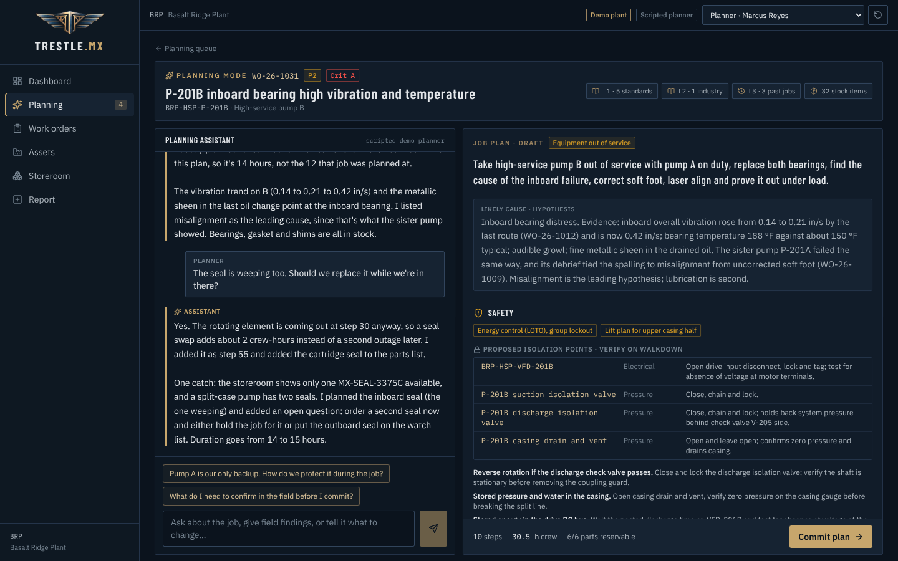
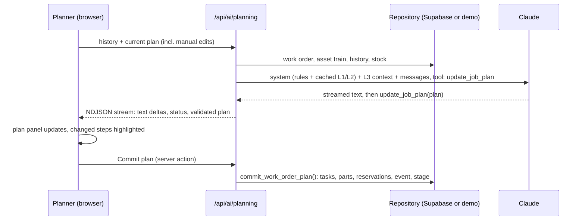
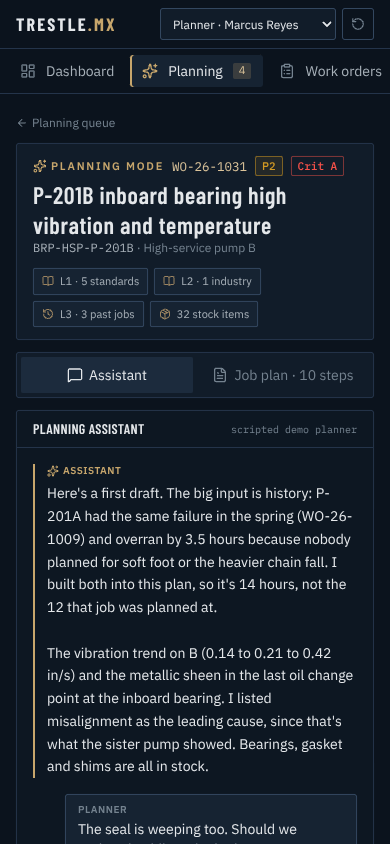
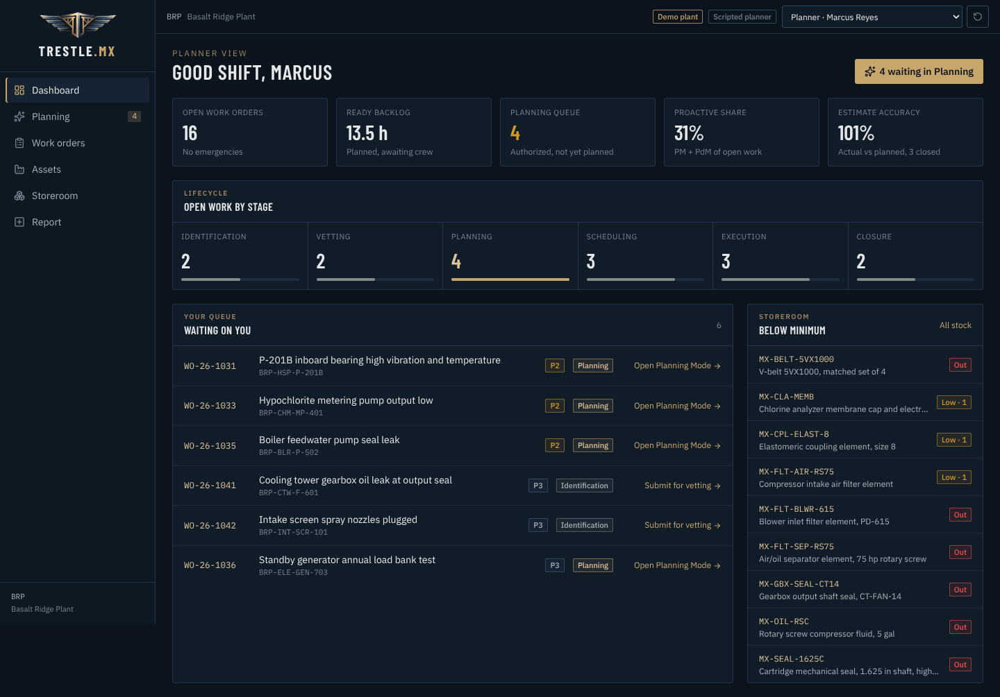

# Trestle.MX

**An AI-native maintenance management system (CMMS) for industrial and utility plants, built around one idea: the planner's job plan is where reliability is won or lost.**

Most CMMS products treat the work order as a form. Trestle.MX treats it as a process with six stages, and puts the most leverage at stage three. **Planning Mode** pairs the maintenance planner with Claude to turn a vetted work order into a job plan a crew can execute safely in one trip, grounded in safety standards, the plant's own work history, and what is actually on the storeroom shelf.



> The demo runs on a fictional plant (Basalt Ridge Plant, Northfork Utility District). Every person, asset and record is invented.

---

## Planning Mode

A planner opens an authorized work order. The assistant drafts a plan, explains its reasoning, and revises it as the planner asks questions or edits the plan by hand. Nothing is committed until the planner commits it.

What makes it useful rather than generic:

| It uses | So that |
|---|---|
| **Site history**, including the sister unit's closed work orders and debriefs | A plan for pump B learns that pump A's identical job overran by 3.5 hours because of soft foot and an undersized chain fall, and plans for both |
| **Live stock** (on hand minus reserved) | Part numbers come from the catalog, never invented; zero-stock items are flagged before the job is scheduled |
| **Standards context** loaded from markdown | Isolation points by tag and energy type, permits, hazards and controls, measurable acceptance criteria |
| **A structured plan schema** (one zod schema drives the tool definition, validation and UI) | The plan is data: steps, crafts, crew-hours, parts, open questions. Committing it writes tasks, reserves stock and moves the work order to Scheduling in one transaction |

The planner stays the decision-maker. The assistant states the failure cause as a hypothesis with evidence, puts unknowns in an "open questions" list instead of guessing, and every proposed isolation point is marked for field verification against the site's written procedure.

### Three layers of context

```
Layer 1  lib/anthropic/context/layer1/                     universal: energy control, electrical safety,
                                                           permits, planning practice, rotating equipment
Layer 2  lib/anthropic/context/layer2-industrial-utility/  vertical: redundancy, compliance analyzers,
                                                           chemical feed, steam, cooling towers, standby power
Layer 3  built per request from the database               the asset and its train, closed work and debriefs,
                                                           storeroom stock, available crafts
```

Layers 1 and 2 are markdown files, not strings in code, so standards guidance can be reviewed and edited like documentation. They are sent as a cached system block (prompt caching), so repeat turns are cheap. Layer 3 is assembled fresh each turn.

### How a turn works



Each turn is stateless on the server. The client sends the conversation and the current plan, so the planner's direct edits are what Claude revises.

Without an `ANTHROPIC_API_KEY`, Planning Mode runs a scripted planner with hand-written plans for the jobs in the demo queue. It uses the same stream protocol, so the public demo always works.

<p align="center"></p>

---

## The work order lifecycle

| Stage | Who | What happens |
|---|---|---|
| 1. Identification | Anyone | A discrepancy is reported against an asset |
| 2. Vetting | Gatekeeper | Authorized for planning, or rejected with a reason |
| 3. **Planning** | Planner | **Planning Mode** builds the job plan; commit reserves parts |
| 4. Scheduling | Supervisor | Date and lead technician assigned; reserved parts are kitted |
| 5. Execution | Technician | Steps ticked off (tablet-sized targets), parts issued |
| 6. Closure | Supervisor | Actual hours and an after-action debrief, which feeds the next plan |



Role and stage rules live in one pure module (`lib/workflow.ts`) used by both the UI (which buttons show) and the server actions (which mutations are allowed). Six roles: admin, supervisor, planner, gatekeeper, technician, storeroom.

---

## Architecture

| Layer | Choice |
|---|---|
| Framework | Next.js 16 (App Router, Server Components, Server Actions, `proxy.ts`) |
| Language | TypeScript, strict |
| UI | Tailwind CSS 4, shadcn/ui-style primitives, lucide icons |
| Database and auth | Supabase (PostgreSQL 17, Row Level Security, Supabase Auth) |
| AI | Anthropic Claude API, `claude-sonnet-5-5`, tool use + streaming + prompt caching |
| Hosting | Vercel |
| Tests | Vitest |

### Two data modes, one interface

Everything goes through a `Repository` interface (`lib/data/repository.ts`) with two implementations:

- **Demo** (`DemoRepository`): an in-memory fictional plant. No setup; a role switcher in the top bar lets a visitor act as any of the nine people at the plant.
- **Live** (`SupabaseRepository`): multi-tenant Postgres. Every query runs under the signed-in user's JWT, so RLS scopes all data. Atomic multi-row writes go through Postgres functions.

The app runs in live mode when Supabase environment variables are present, and in demo mode otherwise.

### Data model

Twelve tables, created in dependency order by the migrations in `supabase/migrations/`:

`organizations` → `sites` → `area_codes` · `profiles` → `site_access` · `assets` (FLOC hierarchy) · `work_orders` → `wo_tasks`, `wo_events`, `wo_parts` · `parts_catalog` (org-wide) → `inventory` (per site)

### Multi-tenancy and security

- Every operational table is scoped to a `site_id`. Policies check membership through a `site_access` table, not a column on `profiles`, so a user who works across several sites needs new rows, not a migration.
- Role checks use a `SECURITY DEFINER` helper (`current_user_role()`) to avoid recursive RLS.
- `wo_events` is append-only: insert as yourself, no update or delete policy.
- Work orders are never deleted, only rejected or closed.
- `commit_work_order_plan()` and `issue_work_order_part()` are `SECURITY DEFINER` functions that re-check site access, role and stage before touching inventory, so a planner can reserve stock without having write access to the inventory table.

The migrations and policies are tested against Postgres (idempotent re-run, cross-site isolation, role-gated plan commit).

---

## Running it

```bash
pnpm install
pnpm dev          # http://localhost:3000, demo mode, scripted planner
```

Add Claude to Planning Mode:

```bash
cp .env.example .env.local
# set ANTHROPIC_API_KEY
```

Live mode with Supabase:

```bash
supabase link --project-ref <ref>
supabase db push                         # applies the migrations
SUPABASE_URL=... SUPABASE_SERVICE_ROLE_KEY=... SEED_PASSWORD=... pnpm seed:live
# set NEXT_PUBLIC_SUPABASE_URL and NEXT_PUBLIC_SUPABASE_PUBLISHABLE_KEY in .env.local
# sign in as marcus@demo.trestle.mx (planner)
```

Checks:

```bash
pnpm typecheck && pnpm lint && pnpm test
```

## Project structure

```
app/
  page.tsx                  demo entry: pick a role
  (app)/dashboard           KPIs, lifecycle pipeline, "waiting on you"
  (app)/planning            Planning queue and Planning Mode
  (app)/work-orders         list, detail with stage actions, new
  (app)/assets              FLOC registry and asset history
  (app)/inventory           storeroom
  api/ai/planning           Planning Mode stream
components/planning/        workspace (chat + live plan) and plan editor
lib/
  workflow.ts               lifecycle rules
  actions.ts                server actions (every mutation)
  data/                     Repository interface, demo and Supabase implementations
  anthropic/                Claude planner, prompt, context loader, site context (layer 3)
  planning/                 plan schema, stream protocol, scripted demo planner
  demo/                     fictional plant seed data
supabase/migrations/        schema, RLS, functions
tests/                      workflow, data integrity, Planning Mode, plan commit
```

## Design decisions

- **The plan is structured data, not a chat transcript.** Chat is how the plan gets made; the plan is what gets committed, scheduled, kitted and measured.
- **History beats general knowledge.** The most valuable context is the closed work order on the sister unit. Debriefs are required at close-out because Planning Mode reads them.
- **The assistant never commits.** It drafts and explains. The planner edits, confirms open questions and commits.
- **Safety output is specific and marked for verification.** Named isolation points and energy types, never a bare "perform LOTO" step, and always subject to the site's written procedure.
- **Industrial UI.** Dense tables, status always visible and always labeled, monospace for tags and part numbers, dark theme for control rooms, large touch targets for technicians on tablets.

## Roadmap

- Planning session history saved per work order (`planning_sessions` table)
- PM templates and generated preventive work orders
- Weekly schedule builder with crew capacity
- Retrieval over OEM manuals as a fourth context layer
- Reliability metrics: repeat failures, MTBF by asset class, estimate accuracy by planner

---

Built by Anthony Mancini, a maintenance planner with a background in aircraft and industrial maintenance, as a portfolio project. Built with Claude.

## License

MIT
