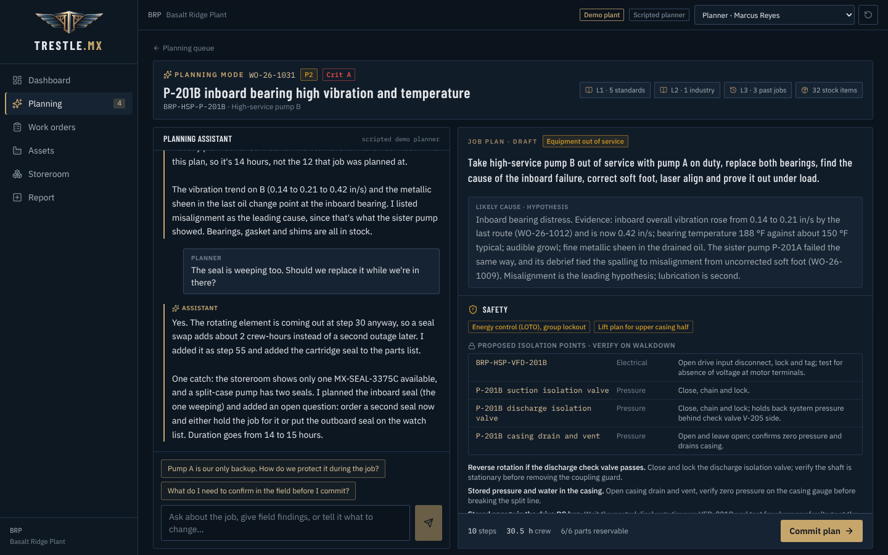
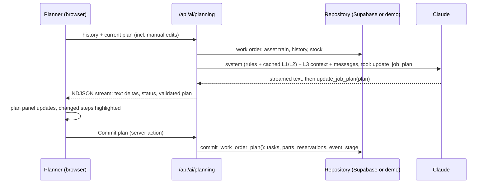
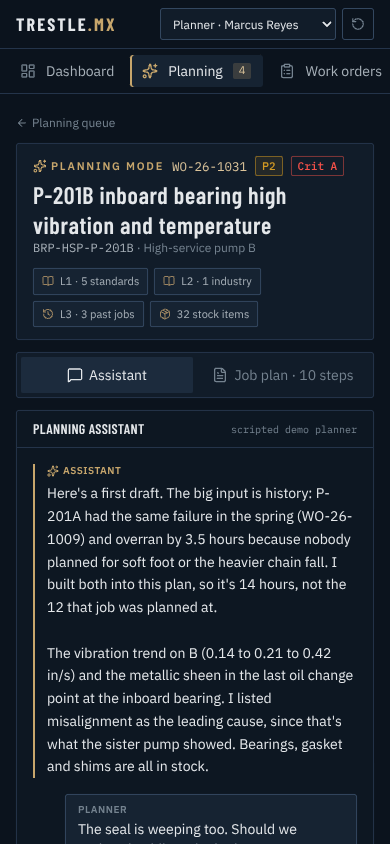
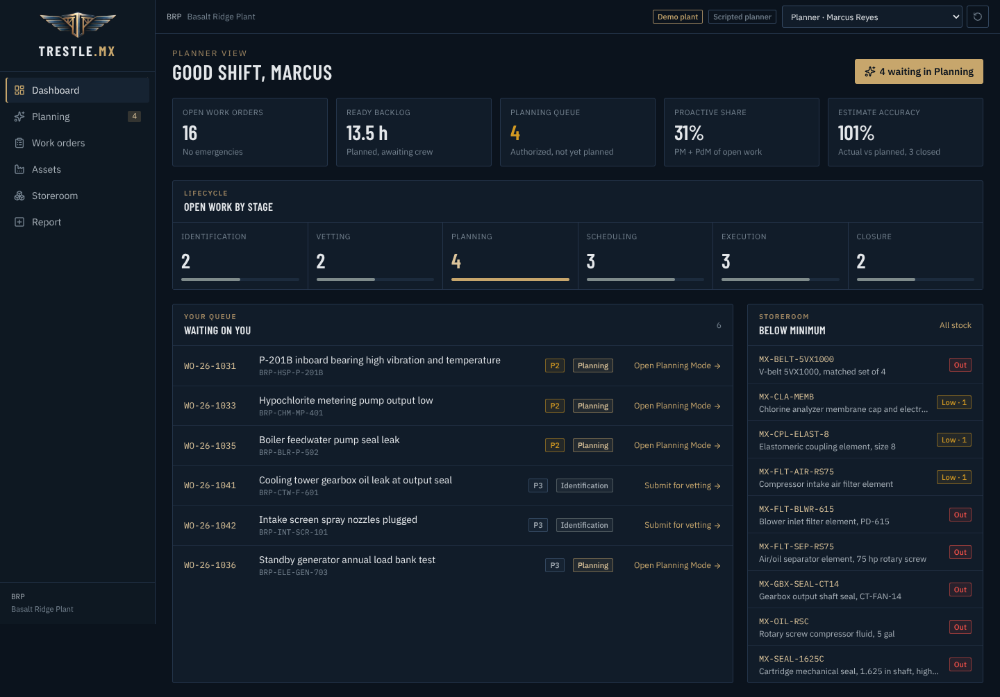

# Trestle.MX

**An AI-native maintenance management system (CMMS) for industrial, utility and data center maintenance, built around one idea: the planner's job plan is where reliability is won or lost.**

Most CMMS products treat the work order as a form. Trestle.MX treats it as a process with six stages, and puts the most leverage at stage three. **Planning Mode** pairs the maintenance planner with Claude to turn a vetted work order into a job plan a crew can execute safely in one trip, grounded in safety standards, the plant's own work history, and what is actually on the storeroom shelf.



> The demo runs on two fictional sites: **Cedar Flats Data Center** (the default) and **Basalt Ridge Plant**, a water and utility plant. Every person, asset and record is invented.

---

## Planning Mode

A planner opens an authorized work order. The assistant drafts a plan, explains its reasoning, and revises it as the planner asks questions or edits the plan by hand. Nothing is committed until the planner commits it.

What makes it useful rather than generic:

| It uses | So that |
|---|---|
| **Site history**, including the sister unit's closed work orders and debriefs | A plan for pump B learns that pump A's identical job overran by 3.5 hours because of soft foot and an undersized chain fall, and plans for both |
| **Live stock** (on hand minus reserved) | Part numbers come from the catalog, never invented; zero-stock items are flagged before the job is scheduled |
| **Standards context** loaded from markdown | Isolation points by tag and energy type, permits, hazards and controls, measurable acceptance criteria |
| **A structured plan schema** (one zod schema drives the tool definition, validation and UI) | The plan is data: steps, crafts, crew-hours, parts, open questions. Committing it writes tasks, reserves stock and moves the work order to Scheduling in one transaction |

The planner stays the decision-maker. The assistant states the failure cause as a hypothesis with evidence, puts unknowns in an "open questions" list instead of guessing, and every proposed isolation point is marked for field verification against the site's written procedure.

### Three layers of context

```
Layer 1  lib/anthropic/context/layer1/                     universal: energy control, electrical safety,
                                                           permits, planning practice, rotating equipment
Layer 2  lib/anthropic/context/layer2-<vertical>/          chosen by the site's vertical:
           layer2-industrial-utility/                      redundancy, compliance analyzers, chemical feed,
                                                           steam, cooling towers, standby power
           layer2-data-center/                             2N and N+1 redundancy, MOPs and change windows,
                                                           liquid cooling, cable plant practice
Layer 3  built per request from the database               the asset and its train, closed work and debriefs,
                                                           storeroom stock, available crafts
```

Layers 1 and 2 are markdown files, not strings in code, so standards guidance can be reviewed and edited like documentation. They are sent as a cached system block (prompt caching), so repeat turns are cheap. Layer 3 is assembled fresh each turn.

### How a turn works



Each turn is stateless on the server. The client sends the conversation and the current plan, so the planner's direct edits are what Claude revises.

Without an `ANTHROPIC_API_KEY`, Planning Mode runs a scripted planner with hand-written plans for the jobs in the demo queue. It uses the same stream protocol, so the public demo always works.

<p align="center"></p>

---

## Asset class library

A fleet can only compare maintenance site to site if every site describes its equipment the same way. Trestle.MX holds one **asset class library per organization**; sites use it and cannot invent their own classes.

| Each class defines | So that |
|---|---|
| **Required and optional nameplate fields** (typed: number with unit, pick-list, yes/no, text) | Every centrifugal pump carries flow, head, speed, configuration and seal type, at every site |
| **Known failure modes** with ISO 14224 style codes and how each is detected | PM tasks and troubleshooting records point back to the failure they prevent or found |
| **Verticals** it applies to (industrial/utility, data center) | One library serves a mixed portfolio; each site has a vertical |

The starter library (`lib/taxonomy/library.ts`) has 29 classes and 108 failure modes, from centrifugal pumps and transformers to static UPS modules, battery strings, CRAHs and liquid-cooling CDUs. Classes are deliberately broad (configuration is an attribute, not a separate class) so each class has enough members to compare.

The register shows **data quality against the standard**: share of assets classified, share with every required field, and which fields are missing. Incomplete assets can still be saved, because real registers are built up over time, but the gap is always visible. Planning Mode reads the asset's class, nameplate and failure modes, and names the suspected failure mode by code in the plan.

---

## PM program

PM strategy lives in the class library, so every site maintains the same equipment the same way, and every task can be defended by what it prevents.

| Piece | How it works |
|---|---|
| **PM tasks per class** | Strategy (time-based, condition-based, failure-finding), craft, hours, interval, and the **failure modes it addresses**. Starter intervals from general practice, marked as defaults to tune to OEM guidance and site history |
| **Criticality decides the program** | Each task lists the criticalities that get it and can shorten the interval for crit A. A class can be **run to failure** at a criticality: no PM, and no coverage warning |
| **Failure mode coverage** | Each class shows, per criticality, which tasks cover each failure mode and which modes have none, so gaps are visible and tasks with no purpose can't hide |
| **Maintenance index** | One schedule per asset per applicable task: interval, last done, next due. The PM program page shows compliance, overdue and due work across the site |
| **Generation** | PMs due within 14 days become work orders with the template's plan and go straight to Scheduling (no vetting) |
| **Deferrals** | Every deferral needs a supervisor, a reason and a later date. It's logged on the schedule and noted on the open work order |
| **Completion** | Closing a PM work order restarts its interval from the completion date |
| **Critical spares** | Parts each site must hold for its crit A assets of a class (optionally one model), checked against the storeroom |

Planning Mode sees the asset's PM schedule and folds PMs that fall due soon into the same outage. In the database, generation and deferral run as `SECURITY DEFINER` functions that re-check role and site, deferrals are append-only, and a trigger advances the schedule when a PM closes.

---

## Troubleshooting record

Most CMMS records say what was replaced, not why that fixed it. Each WCE keeps one record, written by the people closest to each part of the problem.

| Part | Who | What it holds |
|---|---|---|
| **Operator actions** | Operator | What they saw (running state, alarms, readings), what they tried, what happened, how long it ran after |
| **Findings** | Technician | One test, measurement or inspection per entry: the reading, the unit, the spec or baseline it was judged against, pass, fail or information, and what it rules in or out |
| **Resolution** | Technician or supervisor | Failure mode (from the asset class), mechanism and cause (a controlled list after ISO 14224), the findings that prove the cause, the remedy, the test after the repair with its reading, and a review of the operator's first response: helped, masked the problem, or no effect |
| **Addenda** | Supervisor, planner, admin, or the technician who worked it | Later information on a closed work order, signed and dated under the unchanged record |

Rules:

- **Evidence to close.** A corrective or emergency JCN's WCE -001 can't close without a cause backed by at least one linked finding, or an explicit "no fault found". A cause needs a remedy and a verification reading. A deferral closes without one.
- **Insert-only.** Entries are never edited or deleted. A correction is a new entry that points at the one it corrects; a new resolution replaces the current one and the old one stays on record.
- **Repeat failures.** When corrective work on the same asset closed within the class's repeat window (90 days by default, off for run-to-failure classes), a new discrepancy shows the prior cause and fix to the gatekeeper and planner. The same failure mode within the window counts as a confirmed repeat on the dashboard.
- **Feeds the next plan.** Planning Mode reads the operator actions and findings so far, and the proven cause, fix, verification and operator review behind each past job on the equipment and its train.

In the database, the resolution and its finding links are written by one `SECURITY DEFINER` function, the record tables have no update or delete policies, and a trigger refuses a close without evidence. Photos on findings are designed, not built.

---

## Job control numbers and work center events

Numbering follows the Air Force job control system Trestle.MX started from.

| Piece | How it works |
|---|---|
| **JCN** | `263045000`: 26 = year, 304 = Julian day, 5000 = the site's job ID. Each site has a 4-digit block (Cedar Flats 5000, Basalt Ridge 1000); the job ID counts up from it each day and starts over the next Julian day |
| **WCE** | Each shop's work on a discrepancy is a work center event: `263045000-001`, `-002` … numbered within the JCN. Every WCE runs the full six-stage lifecycle on its own |
| **Close-out order** | WCE -001 belongs to the shop primarily responsible. It closes last, once every other WCE on the JCN is closed, and its close-out is the corrective action summary |
| **Deferral** | A WCE that can't be closed (a known issue that doesn't affect safety, crew or function) is written up under its own new JCN, and the WCE is signed off "Corrective action deferred, see JCN …". Parts it held go back to stock |

In the database a trigger numbers every new work order under a per-site lock, numbers never change, and a trigger refuses closing -001 while other WCEs are open. Existing work orders were numbered from the date they were written up.

---

## Scheduling calendar

One board for the scheduler: what is booked each day, what is coming, and whether the crew has the hours.

| Piece | How it works |
|---|---|
| **Computed, not copied** | The calendar is built from the work orders and PM schedules on every render. A job pushed out, pulled forward, re-planned or deferred anywhere in the app shows in its new place; the board also refreshes every minute |
| **What shows** | Scheduled WCEs on their dates with their stage; PM and PdM work on its due date (generated or not); planned corrective work on its earliest workable day. Corrective work still in vetting or planning is listed below the board with no date. Late work is drawn on today |
| **Corrective work has no due date** | Once planned, it goes on the first day all its parts are on site and every craft it needs has the hours free, after booked work and PMs, highest priority first. Parts not on site carry an expected date (set from the catalog lead time when the plan is committed; the storeroom can change it). A job waiting on a part with no date is listed, not drawn |
| **Multi-day work** | Each plan step has a day (1 = the scheduled date). A WCE shows on each of its days with that day's hours, and moving any day moves the whole WCE. Support work is its own WCE on the job's JCN: a contractor's scaffold goes up on its own day before the main WCE and comes down after |
| **Capacity** | From the technician roster: each tech's craft, shift hours and work days, less time off. Each day shows booked and forecast crew-hours against available hours per craft, and who is away |
| **Drag to schedule** | Drag a scheduled job to another day to move it (logged on the work order as a reschedule, with an optional reason). Drag a ready job from the backlog onto a day, pick the technician (sorted by craft, with their free hours), and it moves to Execution. Every card also has a Move or Schedule button for keyboard and touch |
| **Who schedules** | A site setting. An admin picks the roles (supervisor by default; admin always can). The same setting decides who sees Schedule on a work order |

Drag works with a mouse, a pen or a finger (on touch screens, drag by the grip so the board still scrolls), and anyone who can't schedule sees why. Capacity and placement are tested with a roster of 400 technicians. Links between WCEs (scaffold must be up before the seal job starts) and shift patterns that rotate over more than a week are designed, not built. In the database, scheduling and rescheduling run as `SECURITY DEFINER` functions that check the site's scheduler roles, and a trigger refuses a date or assignee change from anyone else.

---

## Cable plant

At the data center, the cable plant is part of the asset register, so a cable job tells the crew exactly where to work.

| Record | What it holds |
|---|---|
| **Cable tray section** (class `CABLE-TRAY`) | One labeled section of a pathway: wire mesh basket tray, cable ladder rack or solid-bottom tray; service (fiber, copper, power), width, depth, location and elevation, design fill |
| **Installed cable** (class `CABLE`) | Its label, both end points (frame, panel, port), installed length and the storeroom part it is made from |
| **Cable route** (`cable_routes`) | The tray sections the cable runs through, end A to end B, in order |
| **Storeroom cable spec** | Cable type, fiber or conductor count and gauge, length, outer diameter, jacket, both terminations and polarity |

A work order on a cable shows the route, so the technician knows which tray sections to open and work within; a tray section lists the cables it carries. Planning Mode gets the route, end points and replacement spec, names the trays in the plan, and works bend radius limits out from the cable's outer diameter. The database refuses a route through anything but a tray section at the cable's own site.

---

## Sites and verticals

Each site has a vertical (industrial/utility or data center). The core is the same everywhere: lifecycle, roles, Planning Mode, the class library and per-site security. The vertical picks Planning Mode's Layer 2 guidance pack and which classes apply. The top bar switches between the sites a user can access (in the demo, both sites).

---

## The work order lifecycle

| Stage | Who | What happens |
|---|---|---|
| 1. Identification | Anyone | A discrepancy is reported against an asset |
| 2. Vetting | Gatekeeper | Authorized for planning, or rejected with a reason |
| 3. **Planning** | Planner | **Planning Mode** builds the job plan; commit reserves parts |
| 4. Scheduling | Scheduler (supervisor by default; set per site) | Date and lead technician assigned on the scheduling calendar; reserved parts are kitted |
| 5. Execution | Technician | Steps ticked off (tablet-sized targets), parts issued |
| 6. Closure | Supervisor | Actual hours and an after-action debrief, which feeds the next plan |



Role and stage rules live in one pure module (`lib/workflow.ts`) used by both the UI (which buttons show) and the server actions (which mutations are allowed). Seven roles: admin, supervisor, planner, gatekeeper, technician, storeroom, operator.

---

## Architecture

| Layer | Choice |
|---|---|
| Framework | Next.js 16 (App Router, Server Components, Server Actions, `proxy.ts`) |
| Language | TypeScript, strict |
| UI | Tailwind CSS 4, shadcn/ui-style primitives, lucide icons |
| Database and auth | Supabase (PostgreSQL 17, Row Level Security, Supabase Auth) |
| AI | Anthropic Claude API, `claude-sonnet-5-5`, tool use + streaming + prompt caching |
| Hosting | Vercel |
| Tests | Vitest |

### Two data modes, one interface

Everything goes through a `Repository` interface (`lib/data/repository.ts`) with two implementations:

- **Demo** (`DemoRepository`): two in-memory fictional sites. No setup; the top bar switches site and lets a visitor act as anyone who works there. The demo store applies the same per-site scoping the database enforces. Seed dates are relative and the store rebuilds each day, so the demo always shows the current week.
- **Live** (`SupabaseRepository`): multi-tenant Postgres. Every query runs under the signed-in user's JWT, so RLS scopes all data. Atomic multi-row writes go through Postgres functions.

The app runs in live mode when Supabase environment variables are present, and in demo mode otherwise.

### Data model

Twenty-seven tables, created in dependency order by the migrations in `supabase/migrations/`:

`organizations` → `sites` (with a vertical and scheduler roles) → `area_codes` · `profiles` → `site_access`, `crew_shifts`, `time_off` · `asset_classes` (org-wide) → `asset_class_failure_modes`, `pm_tasks`, `asset_class_spares` · `assets` (FLOC hierarchy, class and attributes) → `cable_routes` (cable → tray sections), `pm_schedules` → `pm_deferrals` · `work_orders` → `wo_tasks`, `wo_events`, `wo_parts`, `discrepancy_actions`, `wo_findings`, `wo_resolutions` → `wo_resolution_findings`, `wo_addenda` · `failure_codes` (org-wide) · `parts_catalog` (org-wide, with specs) → `inventory` (per site)

### Multi-tenancy and security

- Every operational table is scoped to a `site_id`. Policies check membership through a `site_access` table, not a column on `profiles`, so a user who works across several sites needs new rows, not a migration.
- Role checks use a `SECURITY DEFINER` helper (`current_user_role()`) to avoid recursive RLS.
- `wo_events` is append-only: insert as yourself, no update or delete policy.
- The class library is readable from any site in the org and writable only by admins. Planners classify assets; they cannot change the standard. A trigger refuses an asset whose class belongs to another organization.
- Work orders are never deleted, only rejected or closed.
- `commit_work_order_plan()` and `issue_work_order_part()` are `SECURITY DEFINER` functions that re-check site access, role and stage before touching inventory, so a planner can reserve stock without having write access to the inventory table.

The migrations and policies are tested against Postgres (idempotent re-run, cross-site and cross-org isolation, role-gated plan commit, admin-only library changes).

---

## Running it

```bash
pnpm install
pnpm dev          # http://localhost:3000, demo mode, scripted planner
```

Add Claude to Planning Mode:

```bash
cp .env.example .env.local
# set ANTHROPIC_API_KEY
```

Live mode with Supabase:

```bash
supabase link --project-ref <ref>
supabase db push                         # applies the migrations
SUPABASE_URL=... SUPABASE_SERVICE_ROLE_KEY=... SEED_PASSWORD=... pnpm seed:live
# set NEXT_PUBLIC_SUPABASE_URL and NEXT_PUBLIC_SUPABASE_PUBLISHABLE_KEY in .env.local
# sign in as owen@demo.trestle.mx (data center planner) or marcus@demo.trestle.mx (plant planner)
```

Checks:

```bash
pnpm typecheck && pnpm lint && pnpm test
```

## Project structure

```
app/
  page.tsx                  demo entry: pick a role
  (app)/dashboard           KPIs, lifecycle pipeline, "waiting on you"
  (app)/planning            Planning queue and Planning Mode
  (app)/work-orders         list, detail with stage actions, new (searchable asset picker)
  (app)/assets              FLOC registry, data quality, asset history
  (app)/asset-classes       class library: data standard, failure modes, PM program, coverage, critical spares
  (app)/schedule            scheduling calendar: booked and forecast work against crew capacity, drag to schedule
  (app)/pm                  PM program: maintenance index, generation, deferrals
  (app)/inventory           storeroom
  api/ai/planning           Planning Mode stream
components/planning/        workspace (chat + live plan) and plan editor
lib/
  workflow.ts               lifecycle rules
  actions.ts                server actions (every mutation)
  data/                     Repository interface, demo and Supabase implementations
  anthropic/                Claude planner, prompt, context loader, site context (layer 3)
  planning/                 plan schema, stream protocol, scripted demo planner
  taxonomy/                 asset class library, starter PM programs and data-quality checks
  pm/                       PM program logic: applicability, due dates, coverage, spares, generated plans
  assets/                   asset search for pickers
  demo/                     fictional sites: data center and utility plant
supabase/migrations/        schema, RLS, functions
tests/                      workflow, data integrity, Planning Mode, plan commit, class library, PM program, cable plant, sites
```

## Design decisions

- **The plan is structured data, not a chat transcript.** Chat is how the plan gets made; the plan is what gets committed, scheduled, kitted and measured.
- **One standard, defended.** Asset classes belong to the organization, not the site. Data gaps are shown, not hidden, so the register earns trust instead of becoming a database nobody believes.
- **History beats general knowledge.** The most valuable context is the closed work order on the sister unit. Debriefs are required at close-out because Planning Mode reads them.
- **The assistant never commits.** It drafts and explains. The planner edits, confirms open questions and commits.
- **Safety output is specific and marked for verification.** Named isolation points and energy types, never a bare "perform LOTO" step, and always subject to the site's written procedure.
- **Industrial UI.** Dense tables, status always visible and always labeled, monospace for tags and part numbers, dark theme for control rooms, large touch targets for technicians on tablets.

## Roadmap

- Planning session history saved per work order (`planning_sessions` table)
- Photos on findings (storage), and repeat-failure trends by asset class in the fleet view
- Fleet view: PM compliance, deferrals, backlog aging and repeat failures compared across sites
- Data center: a colo site, redundancy model (N, N+1, 2N, A/B paths) that warns when a job drops redundancy, MOP fields in the plan, vendor and colo provider scope
- Tray fill tracking from cable outer diameters against each section's design fill
- Scheduling: links between WCEs (start after, finish before), rotating shift patterns, and suggesting a week's schedule for approval
- Retrieval over OEM manuals as a fourth context layer
- Reliability metrics: repeat failures, MTBF by asset class, estimate accuracy by planner

---

Built by Anthony Mancini, a maintenance planner with a background in aircraft and industrial maintenance, as a portfolio project. Built with Claude.

## License

MIT
